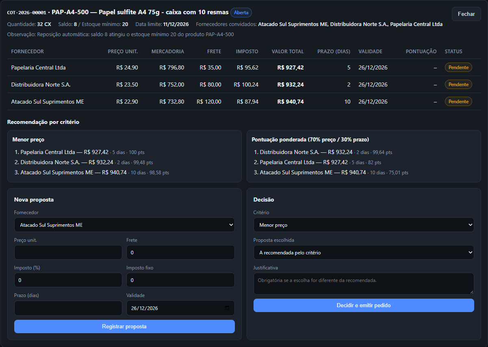

# Sistema de Gestão de Compras e Cotações

[](https://github.com/devraphaeldiniz/gestao-compras-cotacoes/actions/workflows/ci.yml)

API REST em **Java 21 + Spring Boot 3.5** que automatiza o ciclo de compras de reposição: o estoque atinge o mínimo, o sistema abre uma cotação, os fornecedores enviam propostas, o comprador decide com apoio de dois critérios objetivos, o pedido de compra é emitido e o recebimento atualiza o estoque e o custo médio.

Inclui uma interface web leve em **PT/EN** (HTML + CSS + JavaScript puro) que consome a API real, documentação Swagger, migrações Flyway, testes unitários e de integração com **PostgreSQL real via Testcontainers**, Docker e CI no GitHub Actions.

> **English summary:** Purchasing & Quotation Management API. Minimum stock triggers a draft quotation, suppliers submit proposals, the system ranks them by *lowest price* or a *70/30 price/lead-time weighted score*, requires at least 3 valid proposals and a justification for manual overrides, issues the purchase order and, on receipt, updates stock and weighted average cost. All business messages are localized (send `Accept-Language: en` or `?lang=en`).

---

## Telas

**Detalhe da cotação:** propostas com o cálculo de mercadoria, frete e imposto, e o ranking pelos dois critérios. Aqui eles discordam: o menor preço escolhe a Papelaria Central, a pontuação ponderada escolhe a Distribuidora Norte, que entrega em 2 dias.



**Produtos e estoque:** cadastro, movimentação e o alerta de compra quando o saldo chega ao mínimo.


<table>
  <tr>
    <td width="50%"><b>Decisão (interface em inglês):</b> a vencedora pela pontuação ponderada e as demais rejeitadas<br></td>
    <td width="50%"><b>Pedidos de compra:</b> emitidos na decisão; o recebimento atualiza estoque e custo médio<br></td>
  </tr>
</table>

**Swagger:** todos os endpoints documentados em `/swagger-ui.html`.


## Por que este projeto

Em empresas pequenas e médias, compra de reposição costuma viver em planilha e e-mail: ninguém percebe que o item acabou, a cotação é feita com um fornecedor só e a escolha não fica registrada. Este sistema transforma esse processo em regras explícitas e auditáveis:

- **Ninguém esquece de comprar:** saldo no estoque mínimo gera a cotação sozinho, sem duplicar.
- **Concorrência mínima garantida:** a decisão só é liberada com 3 propostas válidas.
- **Decisão defensável:** o sistema recomenda a vencedora; escolher outra exige justificativa, que fica gravada.
- **Custo real no estoque:** o recebimento recalcula o preço médio ponderado incluindo frete e impostos.

## Fluxo

```
 ┌───────────────────┐   saldo <= mínimo    ┌────────────────────┐   PATCH /abrir    ┌──────────────────┐
 │  Estoque mínimo   │ ───────────────────▶ │ Cotação RASCUNHO   │ ────────────────▶ │  Cotação ABERTA  │
 │  (criação/SAIDA/  │   (Regra A, sem      │ qtd = (mín - saldo)│  convidados e     │                  │
 │   AJUSTE)         │    duplicar)         │       + mín        │  data limite      └────────┬─────────┘
 └───────────────────┘                      └────────────────────┘                           │
                                                                                POST /propostas (Regra C)
                                                                                              ▼
 ┌───────────────────┐  POST /receber      ┌────────────────────┐  POST /decidir    ┌──────────────────┐
 │ Estoque atualizado│ ◀────────────────── │  Pedido EMITIDO    │ ◀──────────────── │  3+ propostas    │
 │ saldo + qtd,      │   (Regra E)         │  → RECEBIDO        │   (Regra D)       │  elegíveis       │
 │ último e médio    │                     │                    │  cotação FECHADA  │                  │
 └───────────────────┘                     └────────────────────┘                   └──────────────────┘
```

## Regras de negócio

| Regra | O que faz |
|---|---|
| **A. Necessidade de compra** | Ao criar um produto, ou numa `SAIDA`/`AJUSTE`, se `saldo <= mínimo` e não houver cotação `RASCUNHO`/`ABERTA` do produto, cria uma cotação `RASCUNHO` com quantidade `(mínimo - saldo) + mínimo` (ou `mínimo` se o saldo for igual ao mínimo; nunca zero). |
| **B. Gestão da cotação** | Criação manual em `RASCUNHO` ou `ABERTA` (produto ativo, sem outra em andamento). `PATCH /abrir` só sai de `RASCUNHO`; aceita fornecedores convidados (ativos) e data limite (não passada). |
| **C. Proposta** | Só em cotação `ABERTA`, dentro da data limite, de fornecedor ativo, convidado (se houver lista) e uma por fornecedor. Total = `mercadoria (qtd × preço, 2 casas HALF_UP) + frete + (mercadoria × % + imposto fixo, 2 casas HALF_UP)`. |
| **D. Decisão** | Elegível = `PENDENTE` + fornecedor ativo + validade não vencida. Exige **3+ elegíveis** (senão `422`). Critérios: `MENOR_PRECO` (desempate por prazo e depois maior validade) ou `PONTUACAO_PONDERADA` (70% preço + 30% prazo, prazo 0 = 30 pontos, sem divisão por zero). Escolha diferente da recomendada exige justificativa. A vencedora vira `VENCEDORA`, as demais elegíveis `REJEITADA` e as inelegíveis `DESQUALIFICADA`; a cotação fecha e o pedido é emitido, tudo na mesma transação. |
| **E. Recebimento** | Só pedido `EMITIDO`. `saldo += qtd`; custo efetivo = `total / qtd` (4 casas); preço médio ponderado `((saldoAnt × médioAnt) + (qtd × custo)) / novoSaldo`, ou o próprio custo se não havia médio ou o saldo era zero. |

## Decisões técnicas

- **Flyway + `ddl-auto: validate`:** o schema é versionado em SQL revisável, com `CHECK`, `UNIQUE` e índices no banco; o Hibernate só confere se as entidades batem com ele. Os dados de demonstração ficam em `db/seed` (fora da `V1`), e os testes de integração carregam só `db/migration`.
- **`BigDecimal` em todo valor monetário e quantidade:** sem erro de ponto flutuante; arredondamento `HALF_UP` explícito e num único ponto do cálculo (o percentual de imposto não é arredondado antes de somar o fixo).
- **`FetchType.LAZY` + `@EntityGraph`:** nenhuma associação é carregada sem necessidade; as consultas de listagem e detalhe buscam produto, fornecedor e convidados numa única ida ao banco (sem N+1). `open-in-view` está desligado.
- **MapStruct + Lombok:** mapeamento gerado em tempo de compilação, sem reflexão. A ordem dos processadores no `pom.xml` (Lombok → `lombok-mapstruct-binding` → MapStruct) garante que o MapStruct enxergue os getters gerados. DTOs são `record`s.
- **Critérios de decisão isolados em `AvaliadorPropostasService`:** a regra de ranking é pura (sem repositório), testada à parte e reaproveitada na prévia do detalhe da cotação e na decisão.
- **`Clock` injetado:** validade e prazo usam `LocalDate.now(clock)`, o que torna os testes unitários determinísticos.
- **Erros padronizados e localizados:** exceções carregam a chave da mensagem; o `GlobalExceptionHandler` traduz no idioma da requisição (`Accept-Language` ou `?lang=`) e devolve `400`, `404`, `409` ou `422` com o mesmo formato de corpo.
- **Concorrência tratada no banco:** movimentação de estoque, recebimento e decisão usam bloqueio pessimista (`SELECT ... FOR UPDATE`), e um índice único parcial impede duas cotações em andamento para o mesmo produto. Os testes disparam requisições em paralelo, em threads reais, para provar isso.
- **Testcontainers:** os testes de integração rodam contra PostgreSQL 16 de verdade, com as migrações reais. Nada de H2 com dialeto diferente do de produção.

## Stack

Java 21 · Spring Boot 3.5 (Web, Data JPA, Validation, Actuator) · PostgreSQL 16 · Flyway · MapStruct 1.6 · Lombok · springdoc-openapi · JUnit 5 · Mockito · AssertJ · Testcontainers · Docker · GitHub Actions

## Estrutura

```
src/main/java/com/compras/cotacoes
├── shared        config (OpenAPI, i18n, Clock), exceções + handler global, MensagemService,
│                 entidade auditável e filtro de cabeçalhos de segurança
├── produto       cadastro, movimentação de estoque e Regra A
├── fornecedor    cadastro e ativação/inativação
├── cotacao       criação, abertura, listagem e detalhe com prévia de recomendação (Regra B)
├── proposta      cálculo (Regra C), avaliação e decisão (Regra D)
└── pedido        emissão e recebimento do pedido de compra (Regra E)
src/main/resources
├── db/migration  V1: estrutura · V3: uma cotação em andamento por produto
├── db/seed       V2: dados de demonstração
├── messages*.properties   textos em PT (padrão) e EN
└── static/                interface web PT/EN (index.html, app.js, app.css)
docs/
├── prints/                capturas de tela usadas neste README
└── relatorio-seguranca.md teste de vulnerabilidade completo
```

## Como executar

Pré-requisitos: **Java 21** e **Docker** (o Maven vem pelo wrapper `mvnw`).

### 1. Banco no Docker + aplicação local (desenvolvimento)

```bash
docker compose up -d postgres        # PostgreSQL 16 publicado em localhost:5434
./mvnw spring-boot:run               # Windows: .\mvnw.cmd spring-boot:run
```

A porta do host é **5434** para não conflitar com outro PostgreSQL local; mude com `DB_PORTA_HOST` e `DB_URL` se precisar.

### 2. Tudo em containers

```bash
docker compose --profile app up -d --build
```

Depois de subir:

| O quê | Onde |
|---|---|
| Interface web (PT/EN) | http://localhost:8080 |
| Swagger UI | http://localhost:8080/swagger-ui.html |
| OpenAPI JSON | http://localhost:8080/v3/api-docs |
| Health check | http://localhost:8080/actuator/health |

O seed já traz 3 produtos, 4 fornecedores (1 inativo) e a cotação `COT-AAAA-00001` **aberta com 3 propostas**, pronta para decidir. Os dois critérios apontam vencedores diferentes: o menor preço escolhe a Papelaria Central (R$ 927,42, 5 dias); a pontuação ponderada escolhe a Distribuidora Norte (R$ 932,24, 2 dias, 99,64 pontos).

Para recomeçar do zero: `docker compose down -v` (apaga o volume do banco).

### Variáveis de ambiente

| Variável | Padrão |
|---|---|
| `DB_URL` | `jdbc:postgresql://localhost:5434/compras_db` |
| `DB_USERNAME` / `DB_PASSWORD` | `compras` / `compras` |
| `DB_PORTA_HOST` (Compose) | `5434` |
| `PORT` | `8080` |
| `SWAGGER_ENABLED` | `true` (use `false` em produção) |

## Testes

```bash
./mvnw clean test
```

Roda **61 testes**: 50 unitários (JUnit 5 + Mockito + AssertJ) e 11 de integração (`@SpringBootTest` + MockMvc + Testcontainers). O Docker precisa estar ligado para os de integração.

| Classe | Cobre |
|---|---|
| `ProdutoServiceTest` | Regra A na criação, SAIDA e AJUSTE; não duplicar RASCUNHO/ABERTA; saída maior que o saldo; SKU duplicado |
| `CalculadoraPropostaServiceTest` | Fórmula da Regra C em 6 cenários, valores nulos e o ponto exato do arredondamento |
| `AvaliadorPropostasServiceTest` | `MENOR_PRECO` com desempates; `PONTUACAO_PONDERADA` 70/30, inclusive prazo 0; elegibilidade |
| `PropostaDecisaoServiceTest` | Mínimo de 3; fornecedor inativo; proposta vencida; justificativa obrigatória; pedido emitido e cotação fechada |
| `PedidoCompraServiceTest` | Saldo, último custo e preço médio ponderado; primeira compra; saldo zero; recebimento duplicado |
| `FluxoComprasIntegracaoTest` | Ciclo completo via HTTP no PostgreSQL real, 409 em duplicidade e mensagens em PT, EN e `?lang=` |
| `SegurancaIntegracaoTest` | Regressão do teste de vulnerabilidade: corridas no estoque e no recebimento, 405/415/413, limites numéricos, cabeçalhos e actuator |

## Segurança

A aplicação passou por um teste de vulnerabilidade caixa-branca: SAST com Semgrep, dependências e imagem com Trivy, DAST com OWASP ZAP (scan ativo guiado pelo OpenAPI) e testes manuais de abuso. O relatório completo, com evidências, correções e riscos aceitos, está em **[docs/relatorio-seguranca.md](docs/relatorio-seguranca.md)**.

| | Antes | Depois |
|---|---|---|
| CVEs na imagem (Trivy) | 89 (9 críticas, 32 altas) | 2, avaliadas como não aplicáveis |
| OWASP ZAP | 3 alertas | 120 de 121 regras passam |
| 20 baixas de estoque simultâneas | saldo 23 (3 perdidas) | saldo 20 |
| 10 recebimentos simultâneos do mesmo pedido | 2 aceitos | 1 aceito |

O que ficou em aberto: a API **não tem autenticação**. Esse é o próximo passo antes de qualquer uso real; o relatório descreve a recomendação. O CI roda o Trivy a cada push e falha se surgir uma vulnerabilidade crítica com correção disponível.

## Exemplos com `curl`

Fluxo completo a partir de um banco recém-criado com o seed (fornecedores 1 a 3 ativos e 4 inativo; propostas 1 a 3 já existem). No PowerShell, use `curl.exe`. Os exemplos evitam acentos de propósito: alguns terminais do Windows não enviam o corpo em UTF-8.

```bash
API=http://localhost:8080/api

# 1. Fornecedores
curl -s -X POST $API/fornecedores -H "Content-Type: application/json" \
  -d '{"razaoSocial":"Eletro Componentes Ltda","documento":"12.345.678/0001-90","email":"vendas@eletro.exemplo","prazoMedioDias":4}'
curl -s "$API/fornecedores?ativo=true"

# 2. Produto acima do mínimo e baixa até ficar abaixo (Regra A cria a cotação RASCUNHO id 2)
curl -s -X POST $API/produtos -H "Content-Type: application/json" \
  -d '{"sku":"CAB-HDMI-2M","nome":"Cabo HDMI 2m","unidade":"UN","saldoAtual":40,"estoqueMinimo":15}'
curl -s -X PATCH $API/produtos/4/estoque -H "Content-Type: application/json" -d '{"tipo":"SAIDA","quantidade":30}'
curl -s "$API/produtos?apenasNecessidadeCompra=true"
curl -s "$API/cotacoes?status=RASCUNHO"

# 3. Abrir a cotação convidando fornecedores
curl -s -X PATCH $API/cotacoes/2/abrir -H "Content-Type: application/json" \
  -d '{"fornecedoresIds":[1,2,3],"dataLimite":"2030-12-31"}'

# 4. Propostas (com 2 propostas, decidir retorna 422)
curl -s -X POST $API/cotacoes/2/propostas -H "Content-Type: application/json" \
  -d '{"fornecedorId":1,"precoUnitario":18.90,"valorFrete":25,"impostoPercentual":12,"valorImpostoFixo":0,"prazoEntregaDias":5,"dataValidade":"2030-12-31"}'
curl -s -X POST $API/cotacoes/2/propostas -H "Content-Type: application/json" \
  -d '{"fornecedorId":2,"precoUnitario":19.40,"valorFrete":0,"impostoPercentual":12,"valorImpostoFixo":5,"prazoEntregaDias":1,"dataValidade":"2030-12-31"}'
curl -s -X POST $API/cotacoes/2/decidir -H "Content-Type: application/json" -d '{}'
curl -s -X POST $API/cotacoes/2/propostas -H "Content-Type: application/json" \
  -d '{"fornecedorId":3,"precoUnitario":17.80,"valorFrete":60,"impostoPercentual":12,"valorImpostoFixo":0,"prazoEntregaDias":12,"dataValidade":"2030-12-31"}'

# 5. Detalhe com o ranking dos dois critérios; depois a decisão
curl -s $API/cotacoes/2
curl -s -X POST $API/cotacoes/2/decidir -H "Content-Type: application/json" \
  -d '{"criterio":"MENOR_PRECO","propostaIdEscolhida":4,"justificativaEscolha":"Fornecedor homologado pela engenharia"}'

# 6. Pedido e recebimento (atualiza saldo, último custo e custo médio)
curl -s $API/pedidos-compra
curl -s -X POST $API/pedidos-compra/1/receber
curl -s $API/produtos

# 7. Mensagens em inglês
curl -s -H "Accept-Language: en" $API/cotacoes/999
curl -s "$API/cotacoes/999?lang=en"
```

No passo 5, a cotação tem 20 unidades e o menor preço recomenda a proposta 5 (fornecedor 2, R$ 439,56). Escolher a proposta 4 (R$ 448,36) só é aceito porque há justificativa; sem ela, a API responde `422`.

### Formato de erro

```json
{
  "timestamp": "2026-11-26T12:31:29.80-03:00",
  "status": 422,
  "erro": "Unprocessable Entity",
  "mensagem": "São necessárias no mínimo 3 propostas válidas para decidir; a cotação COT-2026-00002 possui 2",
  "caminho": "/api/cotacoes/2/decidir",
  "campos": []
}
```

## Endpoints

| Método | Rota | Resposta |
|---|---|---|
| `POST` | `/api/produtos` | `201` cadastra (dispara Regra A) |
| `GET` | `/api/produtos?apenasNecessidadeCompra=true` | `200` |
| `PATCH` | `/api/produtos/{id}/estoque` | `200` `ENTRADA`, `SAIDA` ou `AJUSTE` |
| `POST` | `/api/fornecedores` | `201` (`409` se o documento já existe) |
| `GET` | `/api/fornecedores?ativo=true\|false` | `200` |
| `PATCH` | `/api/fornecedores/{id}/status` | `200` |
| `POST` | `/api/cotacoes` | `201` |
| `GET` | `/api/cotacoes?status=RASCUNHO\|ABERTA\|FECHADA\|CANCELADA` | `200` |
| `GET` | `/api/cotacoes/{id}` | `200` detalhe, propostas e prévia dos dois critérios |
| `PATCH` | `/api/cotacoes/{id}/abrir` | `200` |
| `POST` | `/api/cotacoes/{id}/propostas` | `201` |
| `POST` | `/api/cotacoes/{id}/decidir` | `200` vencedora, ranking e pedido gerado |
| `GET` | `/api/pedidos-compra` | `200` |
| `POST` | `/api/pedidos-compra/{id}/receber` | `200` |
