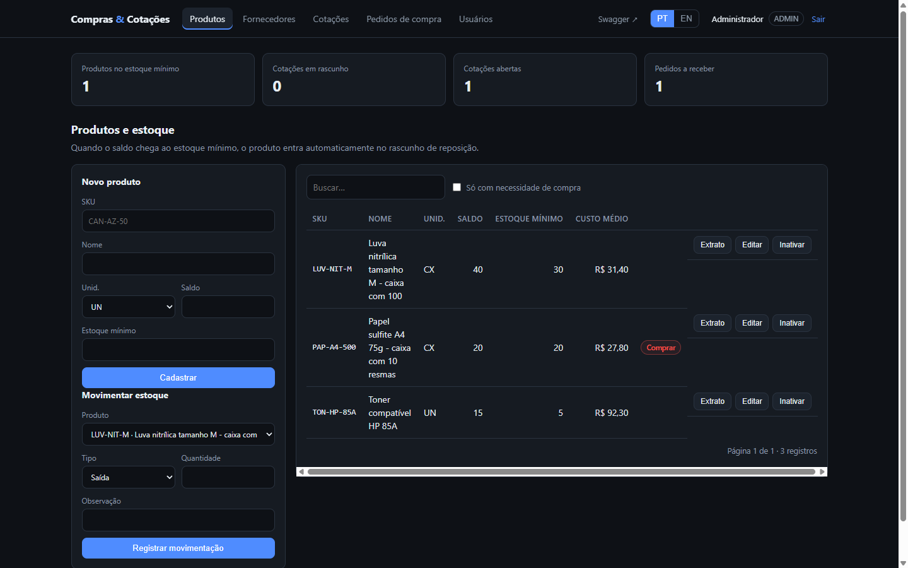
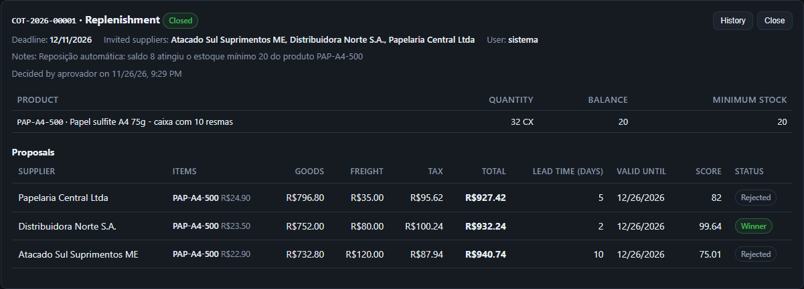
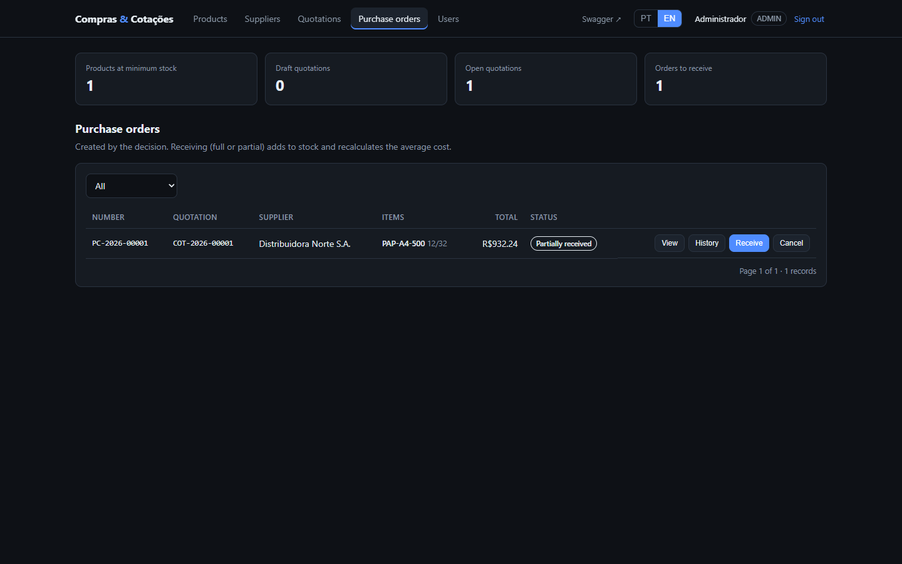
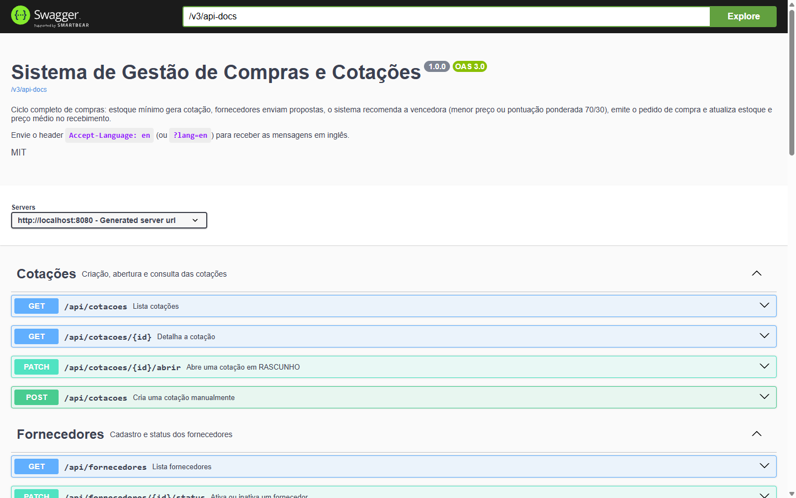

# Sistema de Gestão de Compras e Cotações

[](https://github.com/devraphaeldiniz/gestao-compras-cotacoes/actions/workflows/ci.yml)

API REST em **Java 21 + Spring Boot 4** que automatiza o ciclo de compras de reposição. O fluxo:

1. O estoque atinge o mínimo e o produto entra num rascunho de cotação.
2. Os fornecedores são convidados por e-mail e enviam propostas com preço por item.
3. Um **aprovador** decide com apoio de dois critérios objetivos.
4. O pedido de compra é emitido.
5. O recebimento, total ou parcial, dá entrada no estoque e recalcula o custo médio.

Cada passo fica no histórico com o usuário que o executou.

O projeto também traz:

- interface web leve em **PT/EN** (HTML + CSS + JavaScript puro) que consome a API real;
- login com **JWT** e três perfis;
- documentação Swagger e migrações Flyway;
- testes unitários, de integração com **PostgreSQL real via Testcontainers** e **E2E da interface com Playwright**;
- métricas Prometheus, logs em JSON, Docker e CI no GitHub Actions.

> **English summary:** Purchasing & Quotation Management API (Spring Boot 4, JWT auth with buyer/approver/admin roles).
>
> - Minimum stock adds the product to a replenishment draft quotation, and quotations may have several items.
> - Invited suppliers are e-mailed and submit per-item prices. The system ranks proposals by *lowest price* or a *70/30 price/lead-time weighted score*.
> - Deciding requires at least 3 valid proposals, and choosing another proposal than the recommended one requires a justification.
> - The decision issues the purchase order. Receipts may be partial and update stock and the weighted average cost.
> - A scheduled job cancels expired quotations and reminds suppliers.
> - Every step is recorded in an audit trail and a stock ledger.
> - All business messages are localized (send `Accept-Language: en` or `?lang=en`).

---

## Telas

**Detalhe da cotação:** cotação com dois itens, propostas com preço por item e o cálculo de mercadoria, frete e imposto, e o ranking pelos dois critérios. Aqui eles discordam: o menor preço escolhe a Distribuidora Norte, enquanto a pontuação ponderada escolhe a Atacado Sul, que entrega em 4 dias. A decisão fica bloqueada até haver 3 propostas válidas.


**Produtos e estoque:** cadastro, edição, movimentação com observação, extrato e o alerta de compra quando o saldo chega ao mínimo.



<table>
  <tr>
    <td width="50%"><b>Decisão (interface em inglês):</b> a vencedora pela pontuação ponderada, as demais rejeitadas, e quem decidiu e quando<br></td>
    <td width="50%"><b>Pedidos de compra:</b> recebimento parcial (12 de 32), histórico e cancelamento do saldo<br></td>
  </tr>
</table>

**Swagger:** todos os endpoints documentados em `/swagger-ui.html`. Use o botão *Authorize* com o token do login.



## Por que este projeto

Em empresas pequenas e médias, a compra de reposição costuma viver em planilha e e-mail. Ninguém percebe que o item acabou, a cotação é feita com um fornecedor só e a escolha não fica registrada. Este sistema transforma esse processo em regras explícitas e auditáveis:

- **Ninguém esquece de comprar:** saldo no estoque mínimo põe o produto no rascunho de reposição sozinho, sem duplicar.
- **Concorrência mínima garantida:** a decisão só é liberada com 3 propostas válidas.
- **Segregação de funções:** quem cota (comprador) não decide; quem decide (aprovador) fica registrado.
- **Decisão defensável:** o sistema recomenda a vencedora. Escolher outra exige justificativa, que fica gravada.
- **Custo real no estoque:** o recebimento recalcula o preço médio ponderado com frete e impostos rateados por item.
- **Rastreabilidade:** extrato de estoque por produto e histórico de cada cotação e pedido.

## Fluxo

```
 ┌───────────────────┐   saldo <= mínimo    ┌────────────────────┐   PATCH /abrir    ┌──────────────────┐
 │  Estoque mínimo   │ ───────────────────▶ │ Cotação RASCUNHO   │ ────────────────▶ │  Cotação ABERTA  │
 │  (criação/SAIDA/  │   (Regra A: entra    │ (reposição, vários │  convites por     │                  │
 │   AJUSTE)         │    no rascunho)      │  itens)            │  e-mail           └────────┬─────────┘
 └───────────────────┘                      └────────────────────┘                           │
                                                                        POST /propostas (Regra C, preço por item)
                                                                                              ▼
 ┌───────────────────┐  POST /receber      ┌────────────────────┐  POST /decidir    ┌──────────────────┐
 │ Estoque atualizado│ ◀────────────────── │  Pedido EMITIDO    │ ◀──────────────── │  3+ propostas    │
 │ + extrato         │  total ou parcial   │  → PARCIALMENTE    │  (Regra D,        │  elegíveis       │
 │ (saldo, médio)    │   (Regra E)         │    RECEBIDO        │   APROVADOR)      │                  │
 └───────────────────┘                     │  → RECEBIDO        │  cotação FECHADA  └──────────────────┘
                                           └────────────────────┘
   Job de prazos (de hora em hora): cotação vencida sem 3 propostas válidas → CANCELADA;
   com 3+ → aviso "pronta para decisão"; prazo próximo → lembrete aos convidados que ainda não responderam.
```

## Regras de negócio

| Regra | O que faz |
|---|---|
| **A. Necessidade de compra** | Ao criar um produto, ou numa `SAIDA`/`AJUSTE`, se `saldo <= mínimo` e o produto não está em nenhuma cotação `RASCUNHO`/`ABERTA`, ele entra no rascunho de reposição automática mais recente, ou num novo, com quantidade `(mínimo - saldo) + mínimo` (nunca zero). |
| **B. Gestão da cotação** | Criação manual com **vários itens** (produtos ativos, sem repetir, nenhum em outra cotação em andamento), em `RASCUNHO` ou `ABERTA`. `PATCH /abrir` só sai de `RASCUNHO` e envia convite por e-mail aos fornecedores convidados. `PATCH /cancelar` (com motivo) vale para `RASCUNHO` ou `ABERTA`. |
| **C. Proposta** | Só em cotação `ABERTA`, dentro da data limite, de fornecedor ativo, convidado (se houver lista), uma por fornecedor e com preço para **todos** os itens. Mercadoria = `Σ qtd × preço` (2 casas, `HALF_UP`); total = `mercadoria + frete + (mercadoria × % + imposto fixo)`. |
| **D. Decisão** | Só **APROVADOR**. Uma proposta é elegível quando está `PENDENTE`, o fornecedor está ativo e a validade não venceu. São necessárias **3 ou mais elegíveis**; com menos, a API responde `422`. Critérios: `MENOR_PRECO` (desempate por prazo e maior validade) ou `PONTUACAO_PONDERADA` (70% preço + 30% prazo). Escolha diferente da recomendada exige justificativa. A vencedora vira `VENCEDORA`, as demais `REJEITADA`/`DESQUALIFICADA`. A cotação fecha, o pedido é emitido e quem decidiu fica gravado, tudo numa transação. |
| **E. Recebimento** | Só **APROVADOR**, para pedido `EMITIDO` ou `PARCIALMENTE_RECEBIDO`. Pode ser **parcial** (por item, até o pendente) ou total (sem corpo). O custo efetivo de cada item inclui o rateio de frete e imposto proporcional à mercadoria. O preço médio ponderado é `((saldoAnt × médioAnt) + (qtd × custo)) / novoSaldo`. Cada entrada vai para o extrato. `PATCH /cancelar` encerra o saldo não recebido. |

## Perfis e autenticação

| Perfil | Pode |
|---|---|
| `COMPRADOR` | cadastrar e editar produtos e fornecedores, movimentar estoque, criar, abrir e cancelar cotações, registrar propostas |
| `APROVADOR` | decidir cotações, receber e cancelar pedidos |
| `ADMIN` | tudo acima, além de gerenciar usuários e ler `/actuator/prometheus` |

Todos os perfis consultam tudo (`GET`).

- **Login:** `POST /api/auth/login` devolve um JWT HS256 válido por 8 h; envie-o em `Authorization: Bearer <token>`.
- **Força bruta:** depois de 5 senhas erradas, o usuário fica bloqueado por 15 minutos (resposta `429` com `Retry-After`).
- **Senhas:** guardadas com BCrypt.
- **Usuários de demonstração** (só no seed, `db/seed/V5`): `comprador` / `comprador123`, `aprovador` / `aprovador123` e `admin` / `admin123456`.
- **Produção:** em produção, não carregue `db/seed`. Defina `APP_ADMIN_SENHA` para criar o primeiro ADMIN e `APP_JWT_SEGREDO` com 32 ou mais caracteres.

## Decisões técnicas

- **Spring Boot 4 / Spring Framework 7:** Jackson 3, Hibernate 7, Flyway 12 e Testcontainers 2. Os starters são modulares (`webmvc`, `flyway`, `micrometer-metrics`).
- **Flyway + `ddl-auto: validate`:** o schema é versionado em SQL revisável, com `CHECK`, `UNIQUE` e índices. A `V4` migra os dados existentes (cotação de um produto vira cotação com itens) sem perder nada. Os dados de demonstração ficam em `db/seed`.
- **`BigDecimal` em todo valor monetário e quantidade:** arredondamento `HALF_UP` explícito e num único ponto de cada cálculo.
- **Concorrência tratada no banco:** estoque, recebimento, decisão e inclusão no rascunho de reposição usam bloqueio pessimista (`SELECT ... FOR UPDATE`). Os produtos são travados em ordem de id, para evitar deadlock. Os testes disparam requisições em paralelo, em threads reais, para provar isso.
- **E-mail fora da transação:** o convite é publicado como evento e enviado `@Async` só depois do commit (`@TransactionalEventListener(AFTER_COMMIT)`). Uma falha de SMTP vai para o log e para a tabela de notificações, sem desfazer a abertura.
- **Auditoria:** o histórico (`historico_eventos`) é gravado na mesma transação da ação (`Propagation.MANDATORY`) e descrito no idioma de quem consulta. O extrato (`movimentacoes_estoque`) guarda saldo após, custo e referência.
- **Paginação:** toda listagem devolve `{conteudo, pagina, tamanho, totalElementos, totalPaginas}`. O tamanho máximo é 100 e a ordenação é fixa (sem `sort` livre vindo do cliente).
- **`FetchType.LAZY` + `@EntityGraph`:** nada é carregado sem necessidade e não há N+1. `open-in-view` está desligado.
- **MapStruct + Lombok:** mapeamento gerado em compilação. A ordem dos processadores no `pom.xml` é Lombok → `lombok-mapstruct-binding` → MapStruct.
- **Erros padronizados e localizados:** o `GlobalExceptionHandler` (e o 401/403 da segurança) devolve o mesmo formato de corpo no idioma da requisição.
- **`Clock` injetado:** testes de validade e prazo determinísticos.

## Observabilidade

- **Correlação:** toda resposta traz `X-Request-Id`. Se o cliente envia esse cabeçalho, o valor é reaproveitado. O id vai para o MDC e aparece em cada linha de log daquela requisição.
- **Logs em JSON (ECS):** ative com `LOGGING_STRUCTURED_FORMAT_CONSOLE=ecs`, que já vem ligado no Docker Compose.
- **Métricas Prometheus** em `/actuator/prometheus`, além das métricas de JVM, HTTP e pool:
  - `compras_cotacoes_criadas_total{origem}`
  - `compras_cotacoes_decididas_total{criterio,escolha_manual}`
  - `compras_cotacoes_canceladas_total{motivo}`
  - `compras_pedidos_recebimentos_total{completo}`
  - `compras_pedidos_cancelados_total`
  - `compras_pedidos_valor_BRL` (distribuição do valor dos pedidos: `_count`, `_sum`, `_max`)
  - `compras_autenticacao_falhas_total`
- **Acesso às métricas:** na porta da aplicação, `/actuator/prometheus` exige ADMIN. Em produção, use `MANAGEMENT_SERVER_PORT=8081`, sem publicar essa porta, e o Prometheus coleta sem token pela rede interna.
- **Health:** `/actuator/health` é público e não mostra detalhes.

## Stack

- **Linguagem e framework:** Java 21 · Spring Boot 4.2 (WebMVC, Data JPA, Validation, Security + OAuth2 Resource Server, Mail, Actuator)
- **Dados:** PostgreSQL 16 · Flyway
- **Código:** MapStruct 1.6 · Lombok · springdoc-openapi 3
- **Observabilidade:** Micrometer/Prometheus
- **Testes:** JUnit 5 · Mockito · AssertJ · Testcontainers · Playwright · JaCoCo
- **Infra:** Docker · Mailpit · GitHub Actions

## Estrutura

```
src/main/java/com/compras/cotacoes
├── shared        config, exceções + handler global, i18n, segurança (JWT, perfis, força bruta, cabeçalhos),
│                 paginação, correlation id, validação de CPF/CNPJ, métricas
├── usuario       usuários, login e perfis
├── produto       cadastro, edição, estoque, extrato e Regra A
├── fornecedor    cadastro, edição e ativação/inativação
├── cotacao       cotação com itens, abertura, cancelamento e job de prazos (Regra B)
├── proposta      cálculo por item (Regra C), avaliação e decisão (Regra D)
├── pedido        emissão, recebimento parcial e cancelamento (Regra E)
├── historico     trilha de auditoria
└── notificacao   e-mails aos fornecedores e aos aprovadores
src/main/resources
├── db/migration  V1: estrutura · V3: índice · V4: itens, usuários, auditoria, extrato, notificações
├── db/seed       V2: dados de demonstração · V5: usuários de demonstração
├── messages*.properties   textos em PT (padrão) e EN
└── static/                interface web PT/EN (index.html, app.js, app.css)
```

## Como executar

Pré-requisitos: **Java 21** e **Docker** (o Maven vem pelo wrapper `mvnw`).

### 1. Tudo em containers

```bash
docker compose --profile app up -d --build
```

| O quê | Onde |
|---|---|
| Interface web (PT/EN) | http://localhost:8080 (entre com `comprador`, `aprovador` ou `admin`) |
| Swagger UI | http://localhost:8080/swagger-ui.html |
| Caixa de e-mail (Mailpit) | http://localhost:8025 (convites e lembretes aos fornecedores) |
| Health check | http://localhost:8080/actuator/health |

O seed traz:

- 3 produtos e 4 fornecedores (1 inativo);
- a cotação `COT-AAAA-00001`, **aberta com 3 propostas** e pronta para o aprovador decidir.

Os dois critérios apontam vencedores diferentes: o menor preço escolhe a Papelaria Central (R$ 927,42, 5 dias), e a pontuação ponderada escolhe a Distribuidora Norte (R$ 932,24, 2 dias).

Para recomeçar do zero: `docker compose down -v` (apaga o volume do banco).

### 2. Banco no Docker + aplicação local (desenvolvimento)

```bash
docker compose up -d postgres        # PostgreSQL 16 publicado em localhost:5434
./mvnw spring-boot:run               # Windows: .\mvnw.cmd spring-boot:run
```

A porta do host é **5434** para não conflitar com outro PostgreSQL local. Sem `APP_JWT_SEGREDO`, a chave do JWT é gerada a cada subida (tokens antigos deixam de valer). Com `EMAIL_HABILITADO=false` (o padrão local), os e-mails só aparecem no log.

### Variáveis de ambiente

| Variável | Padrão |
|---|---|
| `DB_URL` | `jdbc:postgresql://localhost:5434/compras_db` |
| `DB_USERNAME` / `DB_PASSWORD` | `compras` / `compras` |
| `APP_JWT_SEGREDO` | vazio = chave aleatória (só desenvolvimento); em produção, 32+ caracteres |
| `APP_JWT_EXPIRACAO` | `8h` |
| `APP_ADMIN_USERNAME` / `APP_ADMIN_SENHA` | `admin` / vazio (com senha, cria o ADMIN se não houver usuários) |
| `EMAIL_HABILITADO` · `MAIL_HOST` · `MAIL_PORT` · `EMAIL_REMETENTE` | `false` · `localhost` · `1025` · `compras@empresa.exemplo` |
| `APP_PRAZOS_HABILITADO` / `APP_PRAZOS_CRON` | `true` / `0 0 * * * *` (de hora em hora) |
| `LOGGING_STRUCTURED_FORMAT_CONSOLE` | vazio (texto); `ecs` = JSON |
| `MANAGEMENT_SERVER_PORT` | mesma porta da aplicação |
| `SWAGGER_ENABLED` | `true` (use `false` em produção) |
| `PORT` · `DB_PORTA_HOST` (Compose) | `8080` · `5434` |

## Testes

```bash
./mvnw clean test          # unitários + integração + cobertura (JaCoCo)
./mvnw test -Pe2e          # E2E da interface num Chromium headless (Playwright)
```

O primeiro comando roda **87 testes**, unitários e de integração. Os de integração usam `@SpringBootTest`, MockMvc e PostgreSQL 16 via Testcontainers, então o Docker precisa estar ligado. O build falha se a cobertura cair abaixo de 80% de linhas ou 65% de branches; hoje está em **90% de linhas e 72% de branches**. O relatório sai em `target/site/jacoco/index.html`.

| Classe | Cobre |
|---|---|
| `ProdutoServiceTest` | Regra A na criação, SAIDA e AJUSTE; consolidação no rascunho de reposição; produto já em andamento; extrato |
| `CalculadoraPropostaServiceTest` | Fórmula da Regra C com vários itens, valores nulos e o ponto exato do arredondamento |
| `AvaliadorPropostasServiceTest` | `MENOR_PRECO` com desempates; `PONTUACAO_PONDERADA` 70/30, inclusive prazo 0; elegibilidade |
| `PropostaDecisaoServiceTest` | Mínimo de 3; fornecedor inativo; proposta vencida; justificativa; quem decidiu |
| `PedidoCompraServiceTest` | Rateio de frete/imposto; recebimento parcial e total; quantidade acima do pendente; preço médio; cancelamento |
| `DocumentoValidoValidatorTest` | Dígitos verificadores de CPF e CNPJ, sequências repetidas e formatação |
| `ProtecaoForcaBrutaTest` | Bloqueio depois de 5 falhas, expiração e reinício |
| `FluxoComprasIntegracaoTest` | Ciclo completo via HTTP, cancelamentos, job de prazos, paginação, histórico e mensagens em PT/EN |
| `AutenticacaoIntegracaoTest` | Login real, 401 sem token, permissões por perfil, força bruta, usuário inativo |
| `SegurancaIntegracaoTest` | Regressão do teste de vulnerabilidade: corridas no estoque e no recebimento, 405/415/413, limites, cabeçalhos e actuator |
| `InterfaceE2E` (perfil `e2e`) | No navegador: comprador cota, aprovador decide e recebe parcialmente, extrato, login inválido, troca de idioma e nenhum erro de console (CSP) |

O CI roda quatro etapas:

- os testes com cobertura;
- o E2E;
- o build da imagem;
- o Trivy, que falha se houver vulnerabilidade crítica com correção disponível.

## Segurança

A aplicação passou por um teste de vulnerabilidade caixa-branca:

- SAST com Semgrep;
- dependências e imagem com Trivy;
- DAST com OWASP ZAP, num scan ativo guiado pelo OpenAPI;
- testes manuais de abuso.

O relatório completo, com evidências, correções e riscos aceitos, está em **[docs/relatorio-seguranca.md](docs/relatorio-seguranca.md)**. O único achado que estava em aberto, a ausência de autenticação (SEC-00), foi resolvido com JWT, perfis e proteção contra força bruta.

| | Antes | Depois |
|---|---|---|
| CVEs na imagem (Trivy) | 89 (9 críticas, 32 altas) | 0 (imagem Spring Boot 4) |
| OWASP ZAP | 3 alertas | 120 de 121 regras passam |
| 20 baixas de estoque simultâneas | saldo 23 (3 perdidas) | saldo 20 |
| 10 recebimentos simultâneos do mesmo pedido | 2 aceitos | 1 aceito |
| Endpoints de escrita sem login | todos | nenhum (401/403 por perfil) |

## Exemplos com `curl`

Fluxo completo a partir de um banco recém-criado com o seed:

- os fornecedores 1 a 3 estão ativos e o 4 está inativo;
- a cotação 1 já tem as propostas 1 a 3.

No PowerShell, use `curl.exe`. Os exemplos evitam acentos de propósito, porque alguns terminais do Windows não enviam o corpo em UTF-8.

```bash
API=http://localhost:8080/api
login() { curl -s -X POST $API/auth/login -H "Content-Type: application/json" \
  -d "{\"username\":\"$1\",\"senha\":\"$2\"}" | sed -E 's/.*"token":"([^"]+)".*/\1/'; }
C="Authorization: Bearer $(login comprador comprador123)"
A="Authorization: Bearer $(login aprovador aprovador123)"
J="Content-Type: application/json"

# 1. Fornecedor (CNPJ com digito verificador valido) e listagem paginada
curl -s -X POST $API/fornecedores -H "$C" -H "$J" \
  -d '{"razaoSocial":"Eletro Componentes Ltda","documento":"11.444.777/0001-61","email":"vendas@eletro.exemplo","prazoMedioDias":4}'
curl -s "$API/fornecedores?ativo=true&pagina=0&tamanho=10" -H "$C"

# 2. Produto acima do minimo e baixa ate ficar abaixo (Regra A cria a cotacao RASCUNHO 2 com 20 UN)
curl -s -X POST $API/produtos -H "$C" -H "$J" \
  -d '{"sku":"CAB-HDMI-2M","nome":"Cabo HDMI 2m","unidade":"UN","saldoAtual":40,"estoqueMinimo":15}'
curl -s -X PATCH $API/produtos/4/estoque -H "$C" -H "$J" -d '{"tipo":"SAIDA","quantidade":30,"observacao":"Requisicao 881"}'
curl -s "$API/cotacoes?status=RASCUNHO" -H "$C"

# 3. Abrir a cotacao convidando fornecedores (convites por e-mail)
curl -s -X PATCH $API/cotacoes/2/abrir -H "$C" -H "$J" -d '{"fornecedoresIds":[1,2,3],"dataLimite":"2030-12-31"}'

# 4. Propostas com preco por item (com 2 propostas, decidir retorna 422)
curl -s -X POST $API/cotacoes/2/propostas -H "$C" -H "$J" -d '{"fornecedorId":1,"itens":[{"produtoId":4,"precoUnitario":18.90}],
  "valorFrete":25,"impostoPercentual":12,"valorImpostoFixo":0,"prazoEntregaDias":5,"dataValidade":"2030-12-31"}'
curl -s -X POST $API/cotacoes/2/propostas -H "$C" -H "$J" -d '{"fornecedorId":2,"itens":[{"produtoId":4,"precoUnitario":19.40}],
  "valorFrete":0,"impostoPercentual":12,"valorImpostoFixo":5,"prazoEntregaDias":1,"dataValidade":"2030-12-31"}'
curl -s -X POST $API/cotacoes/2/decidir -H "$A" -H "$J" -d '{}'
curl -s -X POST $API/cotacoes/2/propostas -H "$C" -H "$J" -d '{"fornecedorId":3,"itens":[{"produtoId":4,"precoUnitario":17.80}],
  "valorFrete":60,"impostoPercentual":12,"valorImpostoFixo":0,"prazoEntregaDias":12,"dataValidade":"2030-12-31"}'

# 5. Comprador nao decide (403); o aprovador escolhe outra proposta com justificativa
curl -s -X POST $API/cotacoes/2/decidir -H "$C" -H "$J" -d '{}'
curl -s $API/cotacoes/2 -H "$A"
curl -s -X POST $API/cotacoes/2/decidir -H "$A" -H "$J" \
  -d '{"criterio":"MENOR_PRECO","propostaIdEscolhida":4,"justificativaEscolha":"Fornecedor homologado pela engenharia"}'

# 6. Recebimento parcial (8 de 20), depois o restante; extrato e historico
curl -s -X POST $API/pedidos-compra/1/receber -H "$A" -H "$J" -d '{"itens":[{"produtoId":4,"quantidade":8}]}'
curl -s -X POST $API/pedidos-compra/1/receber -H "$A"
curl -s "$API/produtos/4/movimentacoes" -H "$C"
curl -s "$API/pedidos-compra/1/historico" -H "$C"

# 7. Mensagens em ingles
curl -s -H "$C" -H "Accept-Language: en" $API/cotacoes/999
curl -s -H "$C" "$API/cotacoes/999?lang=en"
```

No passo 5, o menor preço recomenda a proposta 5 (fornecedor 2, R$ 439,56). Escolher a proposta 4 (R$ 448,36) só é aceito porque há justificativa; sem ela, a API responde `422`.

### Formato de erro

```json
{
  "timestamp": "2026-11-26T12:31:29.80-03:00",
  "status": 422,
  "erro": "Unprocessable Entity",
  "mensagem": "São necessárias no mínimo 3 propostas válidas para decidir; a cotação COT-2026-00002 possui 2",
  "caminho": "/api/cotacoes/2/decidir",
  "campos": []
}
```

## Endpoints

Listagens aceitam `pagina` (base 0) e `tamanho` (máx. 100). Perfil mínimo: **C** = comprador, **A** = aprovador, **ADM** = admin, **todos** = qualquer usuário logado.

| Método | Rota | Perfil | Resposta |
|---|---|---|---|
| `POST` | `/api/auth/login` | público | `200` token (`401` credenciais, `429` bloqueado) |
| `GET` | `/api/auth/eu` | todos | `200` usuário atual |
| `GET` `POST` | `/api/usuarios` | ADM | `200` / `201` |
| `PATCH` | `/api/usuarios/{id}/status` | ADM | `200` |
| `POST` | `/api/produtos` | C | `201` (dispara Regra A) |
| `GET` | `/api/produtos?busca=&ativo=&apenasNecessidadeCompra=` | todos | `200` página |
| `GET` `PUT` | `/api/produtos/{id}` | todos / C | `200` |
| `PATCH` | `/api/produtos/{id}/status` | C | `200` |
| `PATCH` | `/api/produtos/{id}/estoque` | C | `200` `ENTRADA`, `SAIDA` ou `AJUSTE` |
| `GET` | `/api/produtos/{id}/movimentacoes` | todos | `200` extrato paginado |
| `POST` | `/api/fornecedores` | C | `201` (`409` documento duplicado, `400` CPF/CNPJ inválido) |
| `GET` | `/api/fornecedores?busca=&ativo=` | todos | `200` página |
| `GET` `PUT` | `/api/fornecedores/{id}` | todos / C | `200` |
| `PATCH` | `/api/fornecedores/{id}/status` | C | `200` |
| `POST` | `/api/cotacoes` | C | `201` com vários itens |
| `GET` | `/api/cotacoes?status=&produtoId=` | todos | `200` página |
| `GET` | `/api/cotacoes/{id}` | todos | `200` itens, propostas e prévia dos dois critérios |
| `PATCH` | `/api/cotacoes/{id}/abrir` | C | `200` (envia convites) |
| `PATCH` | `/api/cotacoes/{id}/cancelar` | C | `200` (motivo obrigatório) |
| `GET` | `/api/cotacoes/{id}/historico` | todos | `200` |
| `POST` | `/api/cotacoes/{id}/propostas` | C | `201` |
| `POST` | `/api/cotacoes/{id}/decidir` | A | `200` vencedora, ranking e pedido gerado |
| `GET` | `/api/pedidos-compra?status=` | todos | `200` página |
| `GET` | `/api/pedidos-compra/{id}` | todos | `200` |
| `POST` | `/api/pedidos-compra/{id}/receber` | A | `200` parcial (com itens) ou total (sem corpo) |
| `PATCH` | `/api/pedidos-compra/{id}/cancelar` | A | `200` encerra o saldo não recebido |
| `GET` | `/api/pedidos-compra/{id}/historico` | todos | `200` |
| `GET` | `/actuator/health` · `/actuator/prometheus` | público · ADM | `200` |
